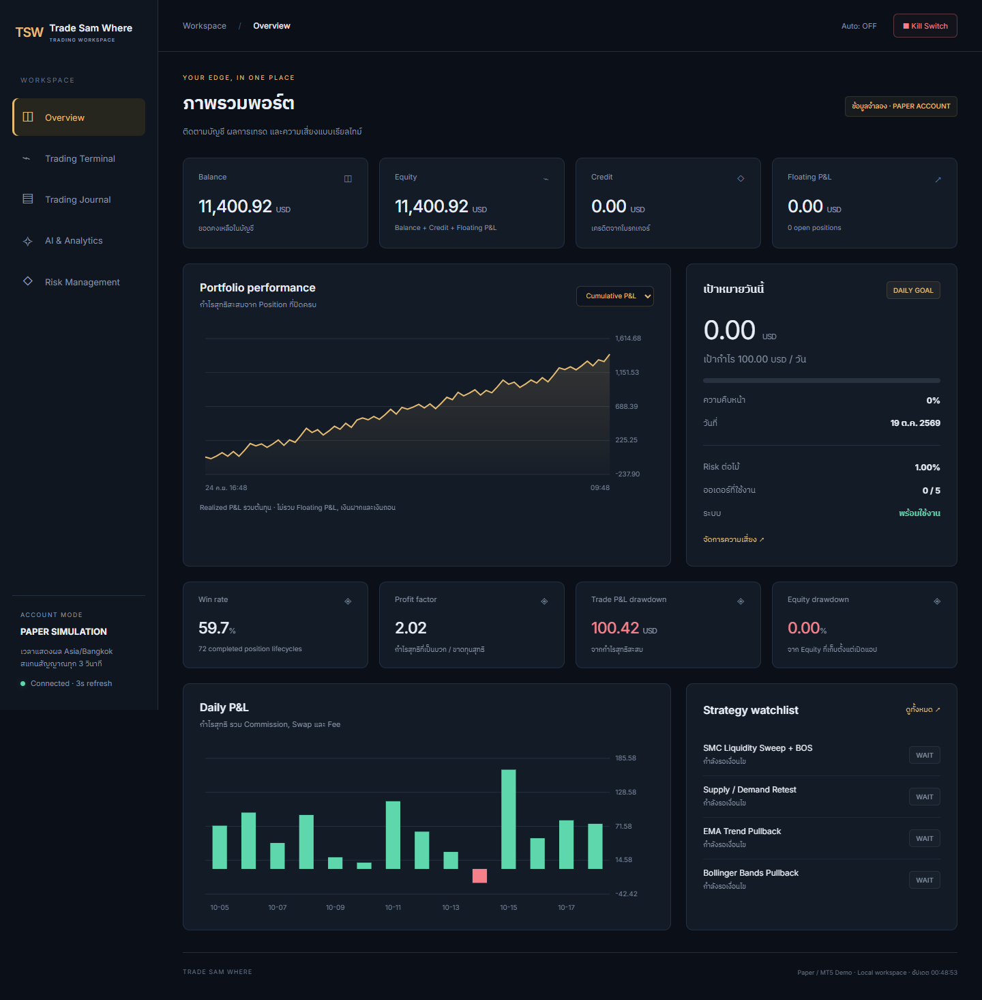
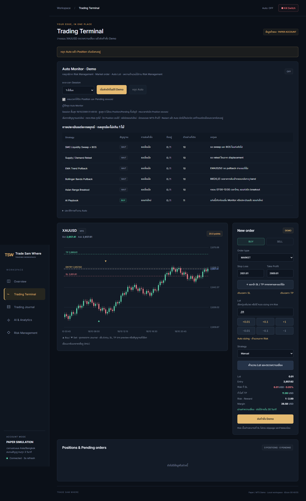
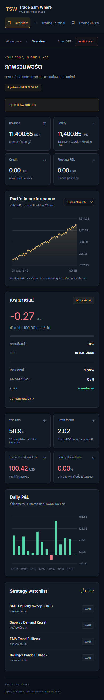

# Trade Sam Where

[](https://github.com/Muegoo/trade-sam-where/actions/workflows/ci.yml)

A local trading workspace for exploring paper orders, portfolio analytics, and risk controls. Built with **FastAPI, SQLite, and vanilla JavaScript**. The default paper mode generates synthetic market/account data and runs independently of MetaTrader 5.



## Try the paper demo

Python 3.12 is used by CI. On macOS or Linux:

```sh
git clone https://github.com/Muegoo/trade-sam-where.git
cd trade-sam-where
python3 -m venv .venv
source .venv/bin/activate
python -m pip install -r requirements.txt
python -m trade_app.server --mode simulation
```

On Windows PowerShell, activate with `.\.venv\Scripts\Activate.ps1` after `py -3.12 -m venv .venv`.

Open **http://127.0.0.1:8000**. The app stores its local state under `data/`, which is excluded from Git. No brokerage credentials or paid API key are required for paper mode.

## What to explore

- **Overview:** account cards, P&L/equity charts, daily results and strategy watchlist.
- **Terminal:** market/limit/stop paper orders, preview before send, positions and cancellation.
- **Journal:** filters, partial-close aggregation and CSV export.
- **Analytics:** rule-based strategy scans and an experimental historical classifier.
- **Risk:** lot limits, stale quotes, spread limits, position exposure, session monitoring and a persistent kill switch.

All paper prices, balances and results are synthetic. Strategy output is experimental; the project does not establish live trading profitability.

| Terminal | Mobile |
|---|---|
|  |  |

## Design

```text
HTML / CSS / JavaScript
          │ HTTP + request validation
       FastAPI
          ├── analytics / strategies / risk
          ├── monitor + idempotent request flow
          ├── SQLite local store
          └── broker interface
                ├── paper simulation (default)
                └── MT5 demo adapter (optional, Windows)
```

Order previews and sends are separate operations. Sends recheck current account scope and risk state; request IDs prevent accidental duplicate execution. Broker outcomes that may be uncertain are not automatically retried.

## Tests

```sh
python -m unittest discover -s tests -p 'test_*.py'
node tests/test_levels.cjs
```

For the full browser walkthrough:

```sh
python -m pip install -r requirements-dev.txt
python -m playwright install chromium
python -m tests.browser_smoke
```

The browser test creates its own temporary paper database. Screenshots and a test export go to ignored `artifacts/`. Set `TRADE_BROWSER_EXECUTABLE` only if using a separately installed Chromium/Chrome instead of Playwright's browser.

## Optional MT5 demo adapter

On a Windows machine with MetaTrader 5 signed into a demo account:

```powershell
python -m pip install -r requirements-mt5.txt
python -m trade_app.server --mode mt5 --symbol XAUUSD
```

Use the symbol name exposed by your demo broker. This adapter is separate from the cross-platform paper demo; real-account order submission is blocked by the application risk checks.

The server is intended for **local use**. It binds to loopback and uses local-host/origin checks and a session token; it is not a hosted, multi-user trading service.

## Project notes

- [Thai usage guide and strategy/risk details](docs/dashboard.md)
- [Original Thai walkthrough, updated to the new name](README.th.md)
- [Architecture and verification notes](docs/portfolio.md)

Screenshots in this repository are from the paper demo. Local databases, CSV exports, credentials and runtime logs are excluded. No project-wide license has been selected yet.
